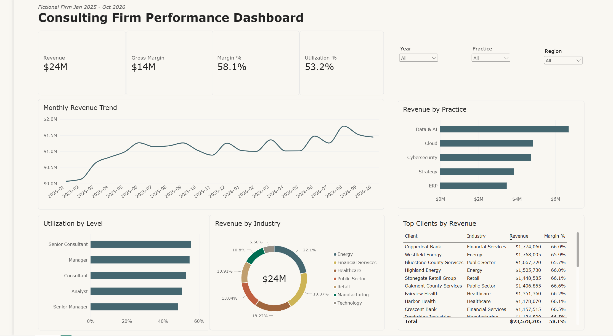

# Consulting Firm Performance Dashboard Example| Power BI

An interactive Power BI dashboard analyzing revenue, profitability, and consultant utilization for a simulated technology consulting firm (Jan 2025 – Oct 2026).



## Overview

Consulting firms run on three numbers: how much they bill, how profitable that work is, and how much of their people's time is billable. This dashboard brings those together in one view so a leader can answer questions like:

- Which practices and clients drive the most revenue?
- Are our margins healthy, and where is profit leaking?
- Are consultants staffed on client work, or sitting on the bench?

Users can filter every visual by **year**, **practice**, and **client region**.

## Dataset

A simulated dataset (Excel, 4 tables) modeled on how a tech consulting firm tracks its work:

| Table | Description | Rows |
|---|---|---|
| Timesheets | Weekly hours per consultant per project, billable or internal | ~11,300 |
| Consultants | Level, practice, office, bill rate, cost rate | 48 |
| Projects | Client, practice, dates, budget, contract type, status | 75 |
| Clients | Client name, industry, region | 25 |

*All names and figures are fictional.*

## Process

### 1. Data cleaning (Power Query)
- Standardized inconsistent practice names (e.g., `cloud`, `CYBERSECURITY`, trailing spaces)
- Normalized billable flags (`Yes`/`Y`, `No`/`N`)
- Removed duplicate timesheet records that would have overstated revenue
- Filled missing client regions and set correct data types

### 2. Data modeling
Built a **star schema** with `Timesheets` as the fact table, related one-to-many to the `Consultants`, `Projects`, and `Clients` dimension tables, plus a custom `Calendar` date table.

### 3. DAX measures

```DAX
Billable Hours = CALCULATE([Total Hours], Timesheets[Billable] = "Y")

Available Hours =
    COUNTROWS(SUMMARIZE(Timesheets, Timesheets[ConsultantID], Timesheets[WeekStartDate])) * 40

Utilization % = DIVIDE([Billable Hours], [Available Hours])

Revenue =
    SUMX(
        FILTER(Timesheets, Timesheets[Billable] = "Y"),
        Timesheets[Hours] * RELATED(Consultants[BillRate])
    )

Labor Cost = SUMX(Timesheets, Timesheets[Hours] * RELATED(Consultants[CostRate]))

Gross Margin = [Revenue] - [Labor Cost]

Margin % = DIVIDE([Gross Margin], [Revenue])
```

### 4. Dashboard design
- KPI cards for Revenue, Gross Margin, Margin %, and Utilization %
- Monthly revenue trend, revenue by practice, utilization by level, revenue by industry, and a ranked client table
- Slicer interactions edited so the client **Region** filter does not distort consultant utilization metrics

## Key Insights

- **$23.6M in revenue at a 58.1% gross margin** over the period.
- **Firm-wide underutilization:** utilization sits around **53%** at every staff level, well below a typical 70–80% target, which points to unsold capacity.
- **Hidden bench cost:** individual clients average about **66%** margin, but the firm overall is **58%**. The gap is the cost of consultants' unbilled internal time.
- **Data & AI is the largest practice**, generating about **$6.7M** in revenue.
- **Reading the trend correctly:** recurring monthly spikes come from months with five weekly timesheet periods, not real swings in demand.

## Tools

Power BI Desktop · Power Query · DAX · Data modeling (star schema)

## How to View

1. Download `Consulting Performance Dashboard.pbix`.
2. Open it in [Power BI Desktop](https://www.microsoft.com/power-bi/desktop) (free, Windows).
3. If prompted, point the data source to `Consulting_Firm_Data.xlsx` from this repo.
